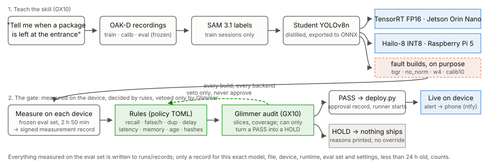

# EdgeGate

EdgeGate measures a new perception skill on each edge chip in a home before it ships, and refuses to deploy what misses the rules. The skill here, "tell me when a package is left at the entrance", was taught from our own recordings (SAM 3.1 labels, a distilled YOLOv8n student) and compiled for a Jetson and a Hailo-8. The rules decide from measurements taken on the device itself. Muse Glimmer, running locally, is a veto-only audit: it reads the measurement evidence, explains it, and can only add a HOLD, never remove one.

Meta Global AI Developer Hackathon, Indie track, "Push the Frontier". Everything in this repository was written between 2026-10-26 and 2026-11-04; the commit history shows when.

**What happened:** we recorded our own sessions, labeled them with SAM 3.1, distilled a small detector, compiled it for a Jetson (TensorRT) and a Raspberry Pi 5 with a Hailo-8, and measured every build on its device over 2 h 50 min of frozen eval recordings. Our best student ran fast on both chips (p95 19.5 ms on the Jetson, 15.9 ms on the Hailo-8) and caught 25 of 26 arrivals, but raised 4.2 false alerts an hour against a limit of 1. **The gate held it, and every one of the twelve builds we broke on purpose.** Nothing was deployed. Section [Results](#results) has the numbers, [What we chose after seeing results](#what-we-chose-after-seeing-results) what a judge should know before trusting them.



## Results

Eval set v2: sessions e01–e06 and u01, 2 h 50 min, 26 scored arrivals (night with one floor lamp, night with the room lights on, a rainy day, and 2 h unattended with no package). Thresholds: event recall ≥ 0.9, ≤ 1 false alert per hour, 0 duplicate alerts, detection delay p95 ≤ 5 s, per-frame latency p95 ≤ 100 ms (Hailo-8: 50 ms), peak memory ≤ 2048 MB, record younger than 24 h. Every row below is one build measured on the device named, scored by `edgegate/events.py` from the device's own detections.

| student | trained on | backend | recall | false/h | dup | delay p95 | latency p95 | verdict, held for |
|---|---|---|---|---|---|---|---|---|
| s1 (YOLOv8n) | t01–t03 | trt | 0.885 | 5.65 | 1 | 3.4 s | 19.4 ms | HOLD: recall, false alerts, duplicates |
| | | hailo8 | 0.846 | 7.06 | 1 | 4.3 s | 15.5 ms | HOLD: recall, false alerts, duplicates |
| s2 (YOLOv8n) | t01, t02, t03 relabeled | trt | 0.731 | 3.18 | 0 | 3.2 s | 19.4 ms | HOLD: recall, false alerts |
| | | hailo8 | 0.731 | 2.12 | 0 | 3.2 s | 15.1 ms | HOLD: recall, false alerts |
| **s3 (YOLOv8n)** | t01–t05 | trt | **0.962** | 4.24 | 0 | 3.3 s | 19.5 ms | HOLD: false alerts |
| | | hailo8 | **0.962** | 4.59 | 1 | 3.0 s | 15.9 ms | HOLD: false alerts, duplicates |
| s4 (YOLOv8s) | t01–t05 | trt | 0.846 | 4.95 | 0 | 3.8 s | 22.9 ms | HOLD: recall, false alerts |
| | | hailo8 | 0.885 | 4.95 | 0 | 3.3 s | 20.9 ms | HOLD: recall, false alerts |

Measured 11/2–11/3 (`logs/measure_*_v2.log`, records in `runs/records/`). s3 is the one improvement round: after s1 missed arrivals in the dark, two more training nights were recorded (t04 under one floor lamp, t05 hard negatives with the lights on) and s3 and s4 were trained once on t01–t05. Recall went from 0.885 to 0.962 and the duplicate alert went away; the false alerts did not. The ONNX reference on the GX10 gives the same recall and false-alert count as the TensorRT build, so the conversion adds nothing on these metrics; whether each false alert is a detection error or the event rule (an edge placement, time hidden behind a person counting toward the dwell) is a separate question. Half of them are in e03 (room lights on, eight minutes of drops and walk-throughs); the two-hour unattended session has none.

**What the numbers do and do not show.** 0.962 is 25 of 26 arrivals: the 95% one-sided lower bound on recall is 0.83, so the observed value clears 0.9 while the true rate is not shown to. The pooled 4.24 false alerts per hour are 12 alerts in the 50 attended minutes (14 per hour while people and boxes move) and none in the 2 unattended hours (95% upper bound 1.5 per hour). On e06, recorded after s1–s4 had been measured on the first eval set, never trained on, and the only session no decision touched, every student caught all four arrivals (lower bound 0.47); s3 raised two false alerts there, both from one box that was set down across the zone's edge and then lifted (see the known limitation below). The thresholds were not changed for any of this.

**False alerts, one by one.** s3's 12 false alerts on v2 (the ONNX run raises the same alerts as the TensorRT build), each watched frame by frame with the detections drawn in:

| cause | alerts | what happened |
|---|---|---|
| the rule: a box in a hand inside the zone | 6 | e03 264 s and 453 s: a box carried through the zone and set down below it. e03 317 s and 469 s, e05 272 s, e06 136 s: a box lifted inside the zone on pickup. A box in a hand counts as present, and time hidden behind the person counts toward the 2 s dwell. |
| the rule: a box across the zone line | 3 | e03 301 s, e04 322 s, e06 75 s: set down across the zone's edge. The human mark says outside; the model's box has its bottom-center inside by a few pixels. |
| detection in the dark | 3 | e01 20 s and e02 269 s: a box on the dark carpet unseen for 12–18 s, so the zone counted as empty, then seen again when the person reached for it and counted as a new arrival. e03 135 s: a phantom package on the shin of a person standing in the zone. |

The one missed arrival (e05 500 s, rainy daylight with the lights off) was never detected at all. So 9 of the 12 false alerts come from the event rule meeting hands and edges, 3 from detection. The next improvement is the rule, not more training: a box moving with a person is not an arrival, and time hidden should not count toward the dwell. That change needs a new policy version and a new eval session; it was not made to this one.

**Fault builds.** From the same s3 and s4 students we also built, on purpose: `bgr` (color channels swapped before the compiler), `no_norm` (input normalization left out), `w4` (4-bit weights on the Hailo-8) and `calib10` (10 calibration images instead of 64). They are candidates like any other and are judged only by their measured metrics. On eval set v1 (e01–e05, u01; a v2 re-measurement is running on 11/3) all twelve were held:

| student | build | backend | recall | false/h | dup | delay p95 | held for |
|---|---|---|---|---|---|---|---|
| s3 | bgr | trt | 0.727 | 3.00 | 1 | 3.5 s | recall, false alerts, duplicates |
| s3 | bgr | hailo8 | 0.773 | 3.38 | 1 | 3.5 s | recall, false alerts, duplicates |
| s3 | no_norm | trt | 0 | 0 | 0 | – | recall, delay (no alert at all) |
| s3 | no_norm | hailo8 | 0 | 0 | 0 | – | recall, delay (no alert at all) |
| s3 | w4 | hailo8 | 0.636 | 3.75 | 4 | 6.8 s | recall, false alerts, duplicates, delay |
| s3 | calib10 | hailo8 | 0.909 | 4.88 | 1 | 3.1 s | false alerts, duplicates |
| s4 | bgr | trt | 0.636 | 4.50 | 1 | 3.3 s | recall, false alerts, duplicates |
| s4 | bgr | hailo8 | 0.727 | 2.63 | 2 | 3.5 s | recall, false alerts, duplicates |
| s4 | no_norm | trt | 0 | 0 | 0 | – | recall, delay (no alert at all) |
| s4 | no_norm | hailo8 | 0.318 | 3.38 | 0 | 2.5 s | recall, false alerts |
| s4 | w4 | hailo8 | 0.273 | **0.375** | 0 | 3.4 s | recall |
| s4 | calib10 | hailo8 | 0.864 | 3.38 | 2 | 3.1 s | recall, false alerts, duplicates |

Two of them say why a gate needs more than one number. `s4 w4` has the fewest false alerts of any build we made, because it misses 73% of the packages: a gate that only watched false alerts would ship it. `s3 calib10` passes recall (0.909) and is held for false alerts and a duplicate; the same fault built from the public YOLOv8n had looked as good as the clean build on 33 public sample frames (112 of 116 boxes matched).

**The four ways to decide**, from the same records (`scripts/compare_gates.py`): always deploy would have shipped all 8 clean builds measured on v2, of which 6 miss more than 10% of arrivals and 8 raise more than one false alert an hour; a false-alert-only gate ships 0 of them (and would ship w4 and the silent no_norm builds); the rules ship 0; the rules plus Glimmer ship 0, with Glimmer's audit of s3 confirming the HOLD and noting that no veto was possible because the rules had already held it. `scripts/dashboard.py` writes all of this to one page (`runs/dashboard.html`).

## How it works

1. **Teach.** The instruction is the policy's `task.instruction`. `scripts/teach.py` takes it typed or spoken (Muse Voice Transcribe), has Muse Spark write the task spec (a name, the classes to detect as SAM text prompts, what alerts, what must not, what to watch) and checks that spec against the policy; it never writes the policy (added 11/3, see below). The OAK-D Pro records sessions as timestamped JPEG frames (`scripts/capture_oak.py`): train sessions with one set of boxes, eval sessions with a different set the student never sees, and a calibration session. SAM 3.1 labels the train sessions from the text prompts "package" and "person" (`scripts/label_sam.py`); a YOLOv8n student is trained on those labels (`scripts/train_student.py`) and exported to a fixed-shape ONNX.
2. **Build.** `scripts/build_candidates.sh` compiles the ONNX into a TensorRT FP16 engine on the Jetson and an INT8 HEF for the Hailo-8 with the Hailo Dataflow Compiler, plus the fault builds (`scripts/inject_fault.py`, `scripts/compile_hailo.py` flags).
3. **Measure.** `scripts/measure.py` runs a build on its device over every eval frame (`scripts/run_backend.py`: letterbox, inference, decoding and NMS on the device, timed per frame), turns the detections into arrival alerts with the policy's event rule, scores them against the human marks and writes a record: model and file hashes, device id and runtime, the eval set hash, the metrics, per-session and per-event rows. `scripts/measure_candidates.py` does it for every build of one student.
4. **Decide.** `edgegate/gate.py` reads the policy and the records and prints PASS or HOLD per backend with reasons. Missing, stale, NaN or failed measurements, another model, another eval set, other event settings, another device or runtime, or a file to deploy that is not the file measured are all HOLD.
5. **Audit.** `scripts/audit.py` gives Glimmer the MCP tools in `edgegate/audit_mcp.py` (rule verdicts, eval coverage, recall per slice by lighting, package size, tag or session) and lets it propose a HOLD for a backend the rules passed, citing evidence ids from that audit. A proposal without evidence is rejected; an audit that does not finish holds every backend the rules passed.
6. **Deploy.** `scripts/deploy.py` takes the same records and files as the gate, plus an audit record if there is one. HOLD prints the reasons and starts nothing; there is no override. PASS writes an approval record and starts the runner on the device, which checks that the approval names its device, its runtime and that exact file before it runs. Arrival alerts go out as an HTTP POST (an ntfy topic on the phone).

Run on 11/3 with the s3 records:

```
$ python3 scripts/deploy.py policies/package_entrance.toml runs/records/s3/reference/*.json runs/records/s3/clean/*.json \
    --model-sha 3672c7b8… --artifact trt=build/s3/student_fp16.engine --artifact hailo8=build/s3/student.hef --notify https://ntfy.sh/…
trt: HOLD, not deployed
    false_alerts_per_h: 4.23877 > max 1
hailo8: HOLD, not deployed
    false_alerts_per_h: 4.592 > max 1
    duplicate_alerts: 1 > max 0
```

### The gate

The rules decide; Glimmer can only veto a PASS and explain. A record counts only for:

- **its device:** the policy's `[targets]` names each backend's device (a hash of its machine id) and runtime version. A record from another device, a reinstalled OS or another runtime version holds.
- **its eval set:** `eval_set_sha256` is a manifest of every frame's sha256 plus the marks, `frames.csv` and `meta.json`; the device reports a digest of the frames it actually read and it must match.
- **its evaluation settings:** `eval_config_sha256` covers the policy's `[events]` (zone, dwell, windows, the measured alert delay) and `[measure]` (class order, detection threshold). Changing any of them voids older records. Thresholds are applied at decision time and are not in the hash.
- **its age:** older than `max_age_hours` (24) is stale.

**Arrival rule** (`edgegate/events.py`, fixed 10/27 before any session was recorded, not tuned): a package whose box bottom-center is inside the zone, seen for 2 s in an empty zone, is an arrival; the alert must be received within 10 s of the package being let go, dwell included. One alert while it stays; a new arrival needs the zone empty, not just hidden by a person, for 2 s. A second package next to the first is out of scope and scored apart. When the camera drops out, the zone state is unknown, not empty.

**What the metrics are:** a recorded-session evaluation. Alert times are recorded frame times; device latency is a separate metric. Alert delivery enters through `notify_s`, the measured delay from the deciding frame to the alert received at the push server (1.2 s, measured 10/30 on the live path with a throwaway student, before any candidate), added to every alert time before the 10 s check. Until it is measured the gate holds everything. **The push server to the phone's screen is not measured**, so "received on the phone within 10 s" is not verified by any record; the 10 s check as applied is release → alert at the push server + 1.2 s. A phone-side value (the screen lighting up in the recorded frames, `measure_delivery.py --phone`) is planned for the live session on 11/3; it goes into a new policy version, because `notify_s` sits in `[events]` and changing it voids every record.

**The PASS path, exercised under a test policy.** No real candidate has passed, so no real approval record exists. The path was run on 10/30 with a throwaway student and a test policy whose thresholds were loosened on purpose (not an evaluation): both devices passed, `deploy.py` wrote the approval records and started the runners, and, streamed the same recording, they alerted at exactly the frame times the recorded-session scoring gives. A model file the approval did not name, and a device it did not name, were refused. Under the real policy the same builds were held and nothing started.

**Glimmer's audit.** Glimmer 30B runs on the GX10 under vLLM in FP8. For s3 it called `gate_decisions` and `eval_coverage`, found both backends already held, proposed nothing, and wrote one paragraph per device with the evidence ids; five repeats on the same records took 169–240 s each, 1–2 tool calls, 0 vetoes, 0 rejected proposals (`runs/audits/s3*.json`). There is no real-record evidence yet that the audit improves a decision: every real candidate was held by the rules, so there was nothing to veto. The evidence for the veto path is synthetic: five cases with a planted slice failure under passing summary metrics (`tests/audit_cases.py`, made-up numbers, not evidence), audited three times each on 11/3 (`runs/audits_synthetic/`, copied to `results/`): 30 of 30 device verdicts as expected, 0 wrong HOLDs on the control, 0 missed HOLDs, 5–12 tool calls and 185–497 s (median 286 s) per audit, every veto citing the evidence ids of the slice it found. A per-slice rule might catch the same planted failures; that comparison was not made.

## What we chose after seeing results

Everything a judge should know before trusting the numbers above.

- **Thresholds and rule first.** The arrival rule was written on 10/27 and the thresholds on 10/28, before any eval session existed. The zone was drawn on the mounted camera on 10/29 before the first session. Neither was changed after seeing eval data.
- **One improvement round, chosen after a HOLD.** s1 (trained on t01–t03) was measured on eval set v1 on 11/1 and held, missing arrivals in the dark sessions. In answer, t04 (night, one floor lamp) and t05 (hard negatives, lights on) were recorded on 11/1 and s3 and s4 were trained on t01–t05. No eval frames and no marks were used in training; the train and eval boxes are different objects. There was no second round.
- **e06 was added after v1.** Eval set v1 (e01–e05, u01) was frozen on 11/1 before any candidate was measured on it. After s1–s4 had been measured on v1, e06 was recorded on 11/2 with a round script fixed before recording, marked, and v2 (v1 + e06) was frozen before any candidate was measured on it. The v1 and v2 verdicts agree; e06 is the unseen check.
- **Marks that were removed.** While marking, five placements were removed as not arrivals under the zone rule because the box lay across the zone's bottom edge with its bottom-center outside: e01 80.2 s and 126.7 s, e02 336.7 s, e03 300.3 s and e06 77.7 s. Placements that ended inside by a few pixels were kept and tagged `edge`. Each decision was made when that session was marked, before any candidate was measured on it, and is written in the session's `data/gt/*.json` notes. u01's zero events were checked with a per-second pixel difference over the zone and by eye.
- **A known limitation of the rule, kept.** A package that is "hidden" by a person box still counts toward the 2 s dwell. A box lifted inside the zone and carried out behind the person can therefore raise an alert; s3's second false alert on e06 (136 s) is one. The rule was frozen before evaluation and was not changed for it.
- **Fault builds were re-measured.** Their v1 records are not valid under v2 (another eval set, and older than 24 h), so the twelve fault builds were measured again on v2 on 11/3. The v1 table above is replaced by the v2 one when it finishes.
- **The phone hop is not measured.** `notify_s` covers the deciding frame to the push server. Nothing in the records says when the phone's screen showed the alert, so the 10 s requirement is verified only up to the push server.
- **Records expire.** The gate holds a record older than 24 h, so the verdicts in `runs/` must be re-measured before any live use; the numbers above are from the records named.
- **The front end came last, and proves less than the headline.** `scripts/teach.py` (one sentence, typed or spoken, to a task spec through Muse Voice Transcribe and Muse Spark) was written on 11/3, after every candidate had been measured. The policy's instruction, classes, zone, rule and thresholds were written by hand before any of that; what the script shows is that the sentence yields the spec the policy already holds, and its classes are the prompts SAM 3.1 was given, not a new input to the pipeline. On five other phrasings ("a parcel shows up at the door", "someone leaves a box by the entrance", "a delivery is dropped off inside the door", "something is left at the door", "watch the entrance for deliveries") Spark gave `person` plus the target noun every time, `package` for three and the sentence's own noun (`parcel`, `box`) for two, and every run reported that its instruction differs from the policy, as it should (`runs/teach/`). On the policy's sentence, spoken through a Kokoro-synthesized WAV, Spark returned the same name, the classes `package, person`, "a package is left unattended in the entrance drop zone" as the event, "a person carrying or walking with a package must not alert" as the non-event, and "low light at night, dim room evenings, package occluded in zone" to watch; the script reports any difference and exits non-zero, as it does for a different sentence (`runs/teach/`, copied to `results/`).
- **Not built.** A Creoqode Nova head turning toward the package, Home Assistant integration and two more backends were in the plan and were not started.

## Sessions

All recorded with the one OAK-D Pro, fixed in place at the indoor drop zone, 1280×720 at 15 fps. Train boxes (brown, black, gray) and eval boxes (white, a robot-arm box) are different objects, and each set was kept out of the other's sessions.

| session | split | light | length | used for |
|---|---|---|---|---|
| t01–t05 | train | lights on; day; hallway only; one floor lamp; lights on (hard negatives) | 10–15 min each | SAM 3.1 labels, student training |
| c01 | calib | lights on, hallway only, floor lamp | 9 min | Hailo-8 calibration images |
| e01, e02 | eval | night, one floor lamp (zone ~11/255) | 5, 7 min | eval set (e01 cut short by a USB error) |
| e03, e04, e06 | eval | night, room lights on | 8, 10, 10 min | eval set |
| e05 | eval | rainy day, lights off | 10 min | eval set |
| u01 | eval | rainy day, unattended | 120 min | eval set, no package |
| m01–m03 | live | night | 2–4 min | alert delivery measurement (`notify_s`) |

## Hardware and external tools

GX10 workstation (NVIDIA GB10): Glimmer, SAM 3.1, training, the ONNX reference. Jetson Orin Nano Super (JetPack 6.2.3, TensorRT 10.3). Raspberry Pi 5 with a Hailo-8 (HailoRT 4.20). HEFs compiled with the Hailo Dataflow Compiler 3.34 on an x86 workstation. OAK-D Pro camera. An Android phone with the ntfy app for alerts. All pre-existing home-lab hardware.

The external tools are used as-is, without modification:

| Tool | Used for |
|---|---|
| vLLM (≥ 0.32) | Serving Muse Glimmer 30B, FP8 |
| facebookresearch/sam3 | SAM 3.1 inference |
| Ultralytics YOLOv8 (AGPL-3.0) and its public COCO `yolov8n.pt` / `yolov8s.pt` | Student architecture and pretrained base; the trained students inherit AGPL-3.0 |
| TensorRT, `trtexec` | Jetson engines |
| Hailo Dataflow Compiler, HailoRT | Hailo-8 HEFs and runtime |
| onnxruntime | The GX10 reference backend |
| DepthAI | OAK-D Pro capture |
| MCP Python SDK | The audit tools Glimmer calls |
| Kokoro-82M | A spoken instruction for the Voice Transcribe check |
| ntfy | Alerts to the phone |

**Meta models used:** Muse Glimmer 30B (local audit agent, open weights, vLLM on the GX10), SAM 3.1 (teacher labels, local), Muse Spark 1.3 and Muse Voice Transcribe through the Meta Model API in the front end (`scripts/teach.py`, added 11/3; with `--base` it uses Muse Spark Open on Baseten instead, which gave the same classes and a closer event sentence in 5 s).

## Running it

```bash
bash scripts/setup_gx10.sh               # model downloads + SAM 3.1, TTS and OAK envs + checks
bash scripts/start_glimmer.sh            # Glimmer vLLM server (:8001, FP8 by default)
python3 -m unittest discover -s tests    # rule engine, evaluator, audit tools, comparison (72 tests)

.venv-oak/bin/python scripts/capture_oak.py t01 --split train --light night --minutes 10   # record a session
scripts/make_student.sh s3 data/sessions/t01 data/sessions/t02 ...   # SAM 3.1 labels for what is unlabeled, then train
python3 scripts/mark_gt.py data/sessions/e01                        # mark arrivals by hand in the browser -> data/gt/e01.json
python3 scripts/measure.py --eval-set-hash --sessions e01,e02,...   # eval set hash for the policy; freeze it there
scripts/build_candidates.sh s3 runs/train/s3/student.pt build/calib.npy   # clean + fault builds: 3 engines, 5 HEFs
python3 scripts/measure_candidates.py s3 --sessions e01,...,u01     # every build on its device -> records + verdict table

.venv-audit/bin/python scripts/audit.py policies/package_entrance.toml runs/records/s3/reference/*.json \
    runs/records/s3/clean/*.json --model-sha SHA --artifact trt=build/s3/student_fp16.engine \
    --artifact hailo8=build/s3/student.hef --label s3
python3 scripts/deploy.py policies/package_entrance.toml runs/records/s3/reference/*.json runs/records/s3/clean/*.json \
    --model-sha SHA --artifact trt=build/s3/student_fp16.engine --artifact hailo8=build/s3/student.hef \
    [--audit runs/audits/s3_X.json] --notify URL
python3 scripts/compare_gates.py                                     # always deploy / false-alert-only / rules / rules + Glimmer
python3 scripts/dashboard.py                                         # -> runs/dashboard.html
```

Live path: `capture_oak.py --stream HOST:8790` sends the camera's JPEG frames to a runner started by `deploy.py`; `scripts/replay.py` streams a recorded session the same way, for tests and for showing what a held build would have done, labeled as a replay. `scripts/measure_delivery.py` runs a build in measurement mode (alerts say TEST, no approval, nothing deployed) to measure `notify_s`.

## Repository

- `edgegate/` — `gate.py` (rules), `events.py` (detections → arrival alerts → scores), `audit.py` and `audit_mcp.py` (Glimmer's tools), `detect.py` (letterbox, decoding, NMS shared by every backend), `stream.py` (frame streaming).
- `policies/package_entrance.toml` — the task, targets, eval set hash, event rule, thresholds.
- `scripts/` — capture, labeling, training, export, compile, fault injection, measurement, audit, deploy, live runner, comparison, dashboard.
- `tests/` — unit tests on synthetic data; `audit_cases.py` builds the synthetic audit cases.
- `docs/pipeline.svg` — the diagram above.
- `results/` — a snapshot of `runs/` taken with `scripts/snapshot_results.sh`: every measurement record and audit, the verdict table per student, the gate comparison and the dashboard page, so the tables above can be checked without the devices (`results/snapshot_at.txt` says when).
- `data/`, `build/`, `runs/`, `logs/` are not in git (recordings, models, training outputs, the live records).
