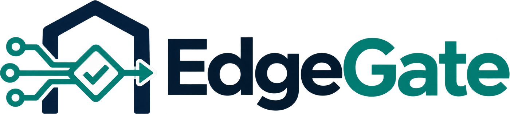
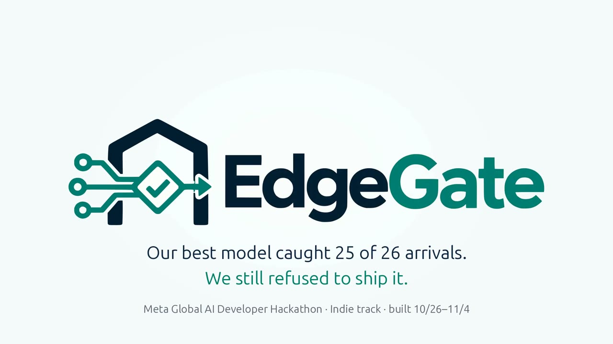
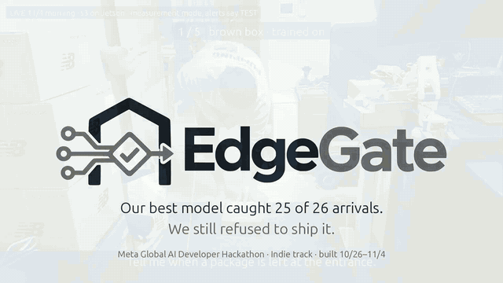
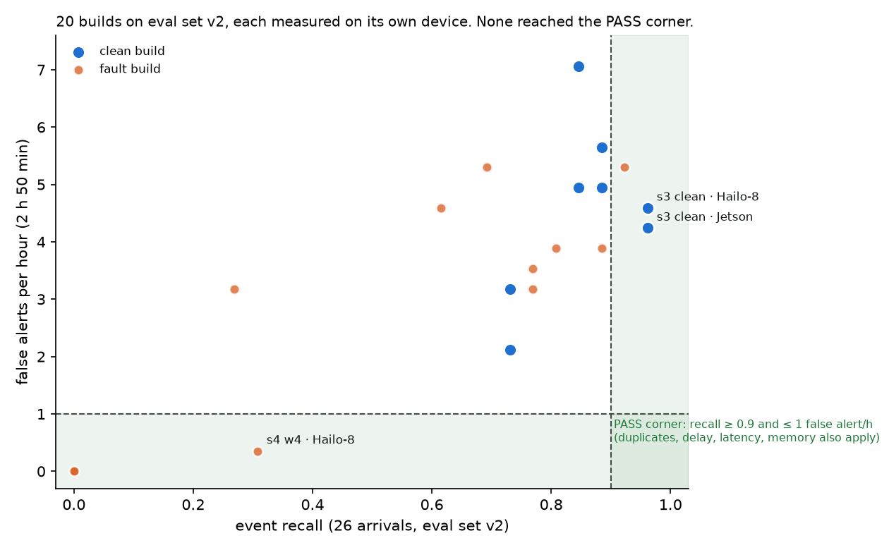
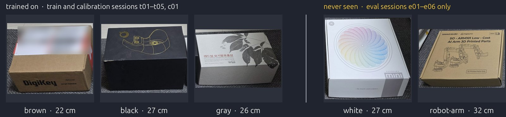

<p align="center">
  <picture>
    <source media="(prefers-color-scheme: dark)" srcset="docs/logo-dark.png">
    
  </picture>
</p>
<p align="center">
  <a href="https://github.com/goodboychan/edgeGate/actions/workflows/ci.yml"></a>
  <a href="LICENSE"></a>
  
  <a href="https://www.youtube.com/watch?v=J4OQVwTwqV8"></a>
  <a href="https://claude.ai/artifact/AJ8DSn9iHrBThySAk8GhPD"></a>
  <a href="https://huggingface.co/datasets/chans/edgegate-package-entrance-eval"></a>
  <br>
  
  
  
  
</p>

<p align="center">
  <a href="https://www.youtube.com/watch?v=J4OQVwTwqV8"></a>
</p>
<p align="center"><br>
<sub>Live on Nov 4: five boxes in turn, three the student trained on and two it never saw, one alert each. The runner is in measurement mode (alerts say TEST); nothing was deployed.</sub></p>

# EdgeGate — a deployment gate for edge vision

*Why a package at the door?* It is the smallest useful thing a home camera can do: say when a parcel has been left.
It is easy to demo and hard to trust on a 3-watt chip at night, and that gap is what EdgeGate measures.

**Measure on the device, then decide.** EdgeGate checks the gap between a model that runs in a demo and one that may be
deployed on the device. It turns one sentence into a small vision model for two edge chips, measures every build on the
chip it will run on, and ships only what passes a policy written before any evaluation. A build that misses the rules
is held, with the reasons printed, and there is no override. It is for teams that must re-validate an edge vision
model after every retrain, quantization, compiler or device change.

**In short.**
- Our best student, s3, caught **25 of 26** arrivals on both chips (p95 19.5 ms on the Jetson, 15.9 ms on the Hailo-8)
  and raised **4.24 false alerts an hour** on the Jetson (4.59 on the Hailo-8) against a limit of 1. HOLD on both;
  nothing deployed.
- **Twelve builds broken on purpose were all held**, including `s4 w4`, which a false-alert-only gate would ship: it stays
  inside the false-alert limit (0.35 an hour) because it catches only 8 of 26 arrivals.
- Four ways to decide, same records: always deploy ships 20, a false-alert-only gate ships 4, the rules ship 0, the
  rules plus Glimmer ship 0 (4 audited, 0 vetoed).
- No build is approved for deployment.
- **A swapped file does not run.** On the PASS path under a test policy (false-alert limit raised to 5, real policy
  untouched), the Jetson runner refused a different model file against the same approval: `not starting: this model
  file is not the approved one` ([`results/pass_path_test/`](results/pass_path_test/), [Positive control](#positive-control)).

> EdgeGate teaches a package-at-the-door skill from one sentence (Muse Spark writes the spec, SAM 3.1 labels our own
> recordings, a YOLOv8n student is distilled), compiles it for a Jetson Orin Nano and a Raspberry Pi 5 with a Hailo-8,
> measures each build on its device over 2 h 50 min of frozen eval recordings, and lets the rules decide. Muse Glimmer
> 30B, open weights on our own GX10, audits the records and can only add a HOLD, never remove one.

**License: [AGPL-3.0](LICENSE)** · Meta Global AI Developer Hackathon, Indie track, "Push the Frontier" · built
2026-10-26 to 2026-11-04, from scratch; the commit history shows when.

**Video (3 min):** https://www.youtube.com/watch?v=J4OQVwTwqV8 · **Results page:** https://claude.ai/artifact/AJ8DSn9iHrBThySAk8GhPD

**Try it in 5 minutes** (no hardware, no key): [Quickstart](#quickstart-one-command-for-the-review) replays every
verdict from the committed evidence; [Judge your own results](#judge-your-own-results) runs the gate on your records.

**Follow one HOLD in the browser** (nothing to install): s3 on the Jetson.
1. The measurement: [`trt_53b17a8db84c_2026-11-03T124704+0000.json`](results/records/s3/clean/trt_53b17a8db84c_2026-11-03T124704+0000.json)
   (event_recall 0.962, false_alerts_per_h 4.24, measured on the Orin Nano).
2. The rule it misses, fixed before any candidate was measured: `false_alerts_per_h = { max = 1.0 }`
   ([`policies/package_entrance.toml`](policies/package_entrance.toml#L75)).
3. The verdict on that record: `HOLD (false_alerts_per_h)`, row `s3 | clean | trt` of
   [`compare_gates.md`](results/compare_gates.md), next to the other 19 builds.
4. Glimmer's audit, bound to that record by its hash: [`s3_20261104T011706Z_r0.json`](results/audits/s3_20261104T011706Z_r0.json)
   (HOLD on both chips, no veto).

**Links** · Eval sessions on the Hugging Face Hub:
[`chans/edgegate-package-entrance-eval`](https://huggingface.co/datasets/chans/edgegate-package-entrance-eval)
(e01–e06 and u01, 2 h 50 min, people blurred, CC BY-NC 4.0) · every measurement record, audit and table:
[`results/`](results/) · the policy: [`policies/package_entrance.toml`](policies/package_entrance.toml).

The logo is a house with an open gate. The circuit entering it is a build, and the checked diamond in the opening is
one that cleared the gate. In this study none did: the mark says what the gate is for, not what happened.

## What is new here

A gate in front of deployment, or a model that proposes while code decides, is not new on its own. What EdgeGate adds
is the combination, measured on the chips themselves:

1. **The same skill, measured per chip.** Every build (clean and fault, TensorRT on the Jetson, HEF on the Hailo-8) runs
   over the same frozen recordings on its own device, with inference, decoding and the event rule timed there. A
   record is valid only for that device, that runtime, that eval set and those event settings, and only for 24 hours.
2. **The rules decide; the model may only veto.** `edgegate/gate.py` reads the policy and the records. Muse Glimmer
   reads the same records through MCP tools, explains the verdict with evidence ids, and can propose a HOLD for a
   build the rules passed. It cannot override a rule HOLD, and an audit that does not finish holds everything.
3. **Approvals that expire with their evidence.** A PASS writes an approval bound to the record's content hash, the
   device, the runtime and the exact file, and it expires when the measurement does, not 24 hours after the approval.
   The runner on the device refuses anything else.
4. **Broken builds as candidates.** Swapped color channels, no normalization, 4-bit weights and a 10-image calibration
   were built from the same students and judged only by their measured metrics. All twelve were held; the one a
   single-metric gate would ship is shown frame by frame.
5. **The line between "better" and "shipped".** One improvement round took recall from 0.885 to 0.962. It is reported
   as what it is; deployment stays HOLD because the false-alert rule says so.

## Judge your own results

Bring your own measurement records and EdgeGate judges them with the same rules this study used. `--now` replays a
decision at a given time and never deploys; without it, a PASS writes an approval and starts the runner on the device.

```bash
python3 scripts/deploy.py policies/package_entrance.toml runs/records/s3/reference/*.json runs/records/s3/clean/*.json \
    --model-sha SHA --artifact trt=build/s3/student_fp16.engine --artifact hailo8=build/s3/student.hef \
    --notify https://ntfy.sh/TOPIC --now 2026-11-03T19:45:13Z      # decisions only, nothing started
```

A record is what `scripts/measure.py` writes on the device: the model and file hashes, the device id and runtime, the
eval set hash, the evaluation-settings hash, the metrics, and per-session and per-event rows. A record counts only for:

- **its device:** the policy's `[targets]` names each backend's device (a hash of its machine id) and runtime version.
  A record from another device, a reinstalled OS or another runtime version holds.
- **its eval set:** `eval_set_sha256` is a manifest of every frame's sha256 plus the marks, `frames.csv` and
  `meta.json`; the device reports a digest of the frames it actually read and it must match.
- **its evaluation settings:** `eval_config_sha256` covers the policy's `[events]` (zone, dwell, windows, the measured
  alert delay) and `[measure]` (class order, detection threshold). Changing any of them voids older records.
  Thresholds are applied at decision time and are not in the hash.
- **its age:** older than `max_age_hours` (24) is stale, and an approval inherits this: it expires when the records it
  rests on do. Everything in `results/` is evidence of what was measured, not a standing approval; a live run needs a
  fresh measurement first.

Missing, stale, NaN or failed measurements, another model, another eval set, other event settings, another device or
runtime, or a file to deploy that is not the file measured are all HOLD, with the failing check named. An audit record
(`scripts/audit.py`) is accepted for a deployment only if it names the content hash of every record being deployed
and the same evaluation settings (`edgegate.gate.audit_binding_problem`); the comparison table applies the same check
before it calls a build audited.

**Arrival rule** (`edgegate/events.py`, fixed 10/27 before any session was recorded, not tuned): a package whose box
bottom-center is inside the zone, seen for 2 s in an empty zone, is an arrival; the alert must be received within 10 s
of the package being let go, dwell included. One alert while it stays; a new arrival needs the zone empty, not just
hidden by a person, for 2 s. A second package next to the first is out of scope and scored apart. When the camera
drops out, the zone state is unknown, not empty.

**What the metrics are.** A recorded-session evaluation. Alert times are recorded frame times; device latency is a
separate metric. Alert delivery enters through `notify_s`, the measured delay from the deciding frame to the alert
received at the push server (1.2 s, measured 10/30 on the live path with a throwaway student, before any candidate),
added to every alert time before the 10 s check; until it is measured the gate holds everything. The last hop, push
server to phone, is measured once and outside the records: on the live session of 11/3 (`l01`, s3 on the Jetson in
measurement mode, the phone face down next to the zone with its camera-flash notification on) the flash was seen
1.7–2.4 s after the deciding frame on all 4 alerts ([`results/delivery_l01.json`](results/delivery_l01.json), from
`measure_delivery.py report --phone --blink`). The 10 s check as applied is still release → alert at the push server
+ 1.2 s: putting the phone value into `notify_s` would change `[events]` and void every record, so it is a reported
number, not a policy one.

## Preflight your own build

Before a build runs on a device, the runner (`scripts/live_device.py`) checks the approval record `deploy.py` wrote
for it, and refuses to start on any problem:

| Check | What must hold |
| --- | --- |
| verdict | the approval says PASS |
| file | `artifact_sha256` is the hash of the model file on the device |
| device, runtime | the approval names this device id and this runtime version |
| expiry | `expires_at` (the record's `measured_at` + `max_age_hours`) is in the future, and not later than the record allows |
| time | `approved_at` is not in the future (more than 5 min) |
| settings | the `[events]` and `[measure]` settings in the approval hash to its own `eval_config_sha256` |

The approval also carries the metrics that passed, the record they came from and the audit that checked them. A
replayed decision (`--now`) never writes one. Arrival alerts go out as an HTTP POST (an ntfy topic on the phone).

## Quickstart: one command for the review

Without hardware or keys, from a fresh clone: the rule engine, the evaluator and the audit tools run on synthetic data,
then the gate comparison and the dashboard are rebuilt from the committed `results/`. The builds are not in git, so the
replay reads the model and file hashes from the records themselves, and `--now` is the snapshot time because records
expire after 24 h.

```bash
pip install numpy opencv-python-headless mcp
python3 -m unittest discover -s tests    # 103 tests, no hardware, no keys
NOW=$(cat results/snapshot_at.txt)
python3 scripts/compare_gates.py --records results/records --audits results/audits --now "$NOW"
python3 scripts/dashboard.py --records results/records --audits results/audits --approvals results/approvals --now "$NOW" --out /tmp/dashboard.html
```

The review layer is deterministic: CI runs these commands on every push and diffs the comparison against
[`results/compare_gates.md`](results/compare_gates.md). `results/snapshot_at.txt` is when the records were copied and
the time the replay judges freshness against; `results/updated_at.txt` is when anything in `results/` last changed (the
audits of 11/4 were added to the 11/3 19:45 UTC snapshot without any record changing; judged at the later time, seven
of the compared records would already be past 24 h).

## Results at a glance

<p align="center"></p>

Numbers come from the committed records. Eval set v2: sessions e01–e06 and u01, 2 h 50 min, 26 scored arrivals (night
with one floor lamp, night with the room lights on, a rainy day, and 2 h unattended with no package). Thresholds: event
recall ≥ 0.9, ≤ 1 false alert per hour, 0 duplicate alerts, detection delay p95 ≤ 5 s, per-frame latency p95 ≤ 100 ms
(Hailo-8: 50 ms), peak memory ≤ 2048 MB, record younger than 24 h.

1. **The gate held our own best model.** s3 caught 25 of 26 arrivals on both chips and raised 4.24 false alerts an
   hour against a limit of 1 ([`results/table_s3.md`](results/table_s3.md), [`results/records/s3/`](results/records/s3/)).
2. **It held every build we broke on purpose**, 12 of 12 ([Positive control](#positive-control)).
3. **Four ways to decide, same records:** always deploy 20, false-alert-only 4, rules 0, rules plus Glimmer 0
   ([`results/compare_gates.md`](results/compare_gates.md), [`results/audits/`](results/audits/)).
4. **Alert delivery is measured on one clock:** deciding frame to the push server 1.2 s (in the policy); to the phone's
   flash 1.7–2.4 s, 4 of 4 alerts on the live session ([`results/delivery_l01.json`](results/delivery_l01.json)).
5. **The refusal is real.** `deploy.py` prints HOLD with the reasons and starts nothing
   ([`results/deploy_s3_hold.txt`](results/deploy_s3_hold.txt)); the PASS path is shown under a labeled test policy.

Every row below is one build measured on the device named, scored by `edgegate/events.py` from the device's own
detections:

| student | trained on | backend | recall | false/h | dup | delay p95 | latency p95 | verdict, held for |
|---|---|---|---|---|---|---|---|---|
| s1 (YOLOv8n) | t01–t03 | trt | 0.885 | 5.65 | 1 | 3.4 s | 19.4 ms | HOLD: recall, false alerts, duplicates |
| | | hailo8 | 0.846 | 7.06 | 1 | 4.3 s | 16.1 ms | HOLD: recall, false alerts, duplicates |
| s2 (YOLOv8n) | t01, t02, t03 relabeled | trt | 0.731 | 3.18 | 0 | 3.2 s | 19.4 ms | HOLD: recall, false alerts |
| | | hailo8 | 0.731 | 2.12 | 0 | 3.2 s | 15.4 ms | HOLD: recall, false alerts |
| **s3 (YOLOv8n)** | t01–t05 | trt | **0.962** | 4.24 | 0 | 3.3 s | 19.5 ms | HOLD: false alerts |
| | | hailo8 | **0.962** | 4.59 | 1 | 3.0 s | 15.9 ms | HOLD: false alerts, duplicates |
| s4 (YOLOv8s) | t01–t05 | trt | 0.846 | 4.95 | 0 | 3.8 s | 22.9 ms | HOLD: recall, false alerts |
| | | hailo8 | 0.885 | 4.95 | 0 | 3.3 s | 21.5 ms | HOLD: recall, false alerts |

s3 is the one improvement round: after s1 missed arrivals in the dark, two more training nights were recorded (t04
under one floor lamp, t05 hard negatives with the lights on) and s3 and s4 were trained once on t01–t05. On the Jetson,
recall went from 0.885 to 0.962 and the duplicate alert went away; the false alerts did not. The ONNX reference on the
GX10 gives the same recall and false-alert count as the TensorRT build, so the conversion adds nothing on these
metrics. Half of the false alerts are in e03 (room lights on, eight minutes of drops and walk-throughs); the two-hour
unattended session has none.

**What the numbers do and do not show.** 0.962 is 25 of 26 arrivals: the 95% one-sided lower bound on recall is 0.83,
so the observed value clears 0.9 while the true rate is not shown to. The pooled 4.24 false alerts per hour are 12
alerts in the 50 attended minutes (14 per hour while people and boxes move) and none in the 2 unattended hours (95%
upper bound 1.5 per hour). On e06, recorded after s1–s4 had been measured on the first eval set, never trained on, and
the only session no decision touched, every student caught all four arrivals (lower bound 0.47); s3 raised two false
alerts there, both from one box that was set down across the zone's edge and then lifted. The thresholds were not
changed for any of this.

**False alerts, one by one.** s3's 12 false alerts on v2 (the ONNX run raises the same alerts as the TensorRT build),
each watched frame by frame with the detections drawn in:

| cause | alerts | what happened |
|---|---|---|
| the rule: a box in a hand inside the zone | 6 | e03 264 s and 453 s: a box carried through the zone and set down below it. e03 317 s and 469 s, e05 272 s, e06 136 s: a box lifted inside the zone on pickup. A box in a hand counts as present, and time hidden behind the person counts toward the 2 s dwell. |
| the rule: a box across the zone line | 3 | e03 301 s, e04 322 s, e06 75 s: set down across the zone's edge. The human mark says outside; the model's box has its bottom-center inside by a few pixels. |
| detection in the dark | 3 | e01 20 s and e02 269 s: a box on the dark carpet unseen for 12–18 s, so the zone counted as empty, then seen again when the person reached for it and counted as a new arrival. e03 135 s: a phantom package on the shin of a person standing in the zone. |

The one missed arrival (e05 500 s, rainy daylight with the lights off) was never detected at all. So 9 of the 12 false
alerts come from the event rule meeting hands and edges, 3 from detection. The next improvement is the rule, not more
training: a box moving with a person is not an arrival, and time hidden should not count toward the dwell. That change
needs a new policy version and a new eval session; it was not made to this one.

**The four ways to decide.** From the same records (`scripts/compare_gates.py`,
[`results/compare_gates.md`](results/compare_gates.md)): always deploy would have shipped all 20 builds measured on v2
(8 clean, 12 faults), of which 17 miss more than 10% of arrivals and 16 raise more than one false alert an hour; a
false-alert-only gate ships 4 of them, the three `no_norm` builds that never alert and `s4 w4`; the rules ship 0; the
rules plus Glimmer ship 0, with Glimmer's audits of s3 and of the `w4` builds confirming each HOLD and noting that no
veto was possible because the rules had already held them. An audit counts for a build only when it names that build's
measurement record and the same evaluation settings, the check `deploy.py` makes before it accepts an audit; the s3,
`s3 w4` and `s4 w4` records of 11/3 were audited again on 11/4 for that reason, and the 11/2–11/3 audits of their
earlier measurements stay in [`results/audits/`](results/audits/) as evidence about those measurements only.
`scripts/dashboard.py` writes all of this to one page ([`results/dashboard.html`](results/dashboard.html)).

## How EdgeGate uses Meta models

| Meta model | Where | What it does |
|---|---|---|
| **Muse Glimmer 30B**, open weights, vLLM FP8 on the GX10 | `edgegate/audit.py`, `edgegate/audit_mcp.py`, `scripts/audit.py` | The veto-only auditor: reads the records through MCP tools, explains the verdict, can add a HOLD and never remove one |
| **SAM 3.1**, local (`facebookresearch/sam3`) | `scripts/label_sam.py` | The teacher: labels "package" and "person" on our own train recordings; the YOLOv8n student is distilled from them |
| **Muse Spark 1.3**, Meta Model API | `scripts/teach.py` | Writes the task spec (name, classes as SAM prompts, what alerts, what must not) from one sentence; the spec is checked against the policy, never written into it |
| **Muse Voice Transcribe 1.0**, Meta Model API | `scripts/teach.py --wav` | The spoken sentence to text |
| **Muse Spark Open**, open weights on Baseten | `scripts/teach.py --base` | The same task spec on open weights |

None of them decides what ships. The rules in `edgegate/gate.py` do, from measurements taken on the device.

**What each one actually contributed, kept apart.**
- **SAM 3.1:** the labels every student was trained on. Without it there is no student; this is the one model whose
  contribution the results depend on.
- **The device measurements and the deterministic rules:** every deployment verdict in this repository.
- **Muse Glimmer:** an audit opinion with evidence ids and the possibility of a veto. On the real records it changed no
  verdict, because the rules had already held every build; its veto is shown on synthetic cases only. The test that
  would show its worth, a new failure case where a per-slice rule and the audit are compared on missed failures,
  needless HOLDs and time, was not run.
- **Muse Spark and Muse Voice Transcribe:** the task spec from one sentence, written after the candidates were measured.
  The policy itself was written by hand.

**What Glimmer did.** For s3 it called `gate_decisions` and `eval_coverage`, found both backends already held, proposed
nothing, and wrote one paragraph per device with the evidence ids; five repeats on the same records (11/2) took
169–240 s each, 1–2 tool calls, 0 vetoes, 0 rejected proposals, and the audit of the re-measured 11/3 records on 11/4
took 163 s with the same outcome ([`results/audits/`](results/audits/)). There is no real-record evidence yet that the
audit improves a decision: every real candidate was held by the rules, so there was nothing to veto. The evidence for
the veto path is synthetic ([Positive control](#positive-control)). Why Glimmer: open weights that run where the data
is, and a strict tool protocol with evidence ids. It was not compared with other models.

**Where the front end stands.** `scripts/teach.py` (one sentence, typed or spoken, to a task spec through Muse Voice
Transcribe and Muse Spark) was written on 11/3, after every candidate had been measured. The policy's instruction,
classes, zone, rule and thresholds were written by hand before any of that; what the script shows is that the sentence
yields the spec the policy already holds, and its classes are the prompts SAM 3.1 was given, not a new input to the
pipeline. On five other phrasings ("a parcel shows up at the door", "someone leaves a box by the entrance", "a delivery
is dropped off inside the door", "something is left at the door", "watch the entrance for deliveries") Spark gave
`person` plus the target noun every time, `package` for three and the sentence's own noun (`parcel`, `box`) for two, and
every run reported that its instruction differs from the policy, as it should. On the policy's sentence, spoken through
a Kokoro-synthesized WAV, Spark returned the same name, the classes `package, person`, "a package is left unattended in
the entrance drop zone" as the event, "a person carrying or walking with a package must not alert" as the non-event,
and "low light at night, dim room evenings, package occluded in zone" to watch; the script reports any difference and
exits non-zero, as it does for a different sentence ([`results/teach/`](results/teach/)). With `--base` it uses Muse
Spark Open on Baseten instead of Muse Spark 1.3, which gave the same classes and a closer event sentence in 5 s.

## Pipeline


1. **Teach.** The instruction is the policy's `task.instruction`. `scripts/teach.py` takes it typed or spoken, has Muse
   Spark write the task spec and checks that spec against the policy; it never writes the policy. The OAK-D Pro records
   sessions as timestamped JPEG frames (`scripts/capture_oak.py`): train sessions with one set of boxes, eval sessions
   with a different set the student never sees, and a calibration session. SAM 3.1 labels the train sessions from the
   text prompts "package" and "person" (`scripts/label_sam.py`); a YOLOv8n student is trained on those labels
   (`scripts/train_student.py`) and exported to a fixed-shape ONNX.
2. **Build.** `scripts/build_candidates.sh` compiles the ONNX into a TensorRT FP16 engine on the Jetson and an INT8 HEF
   for the Hailo-8 with the Hailo Dataflow Compiler, plus the fault builds (`scripts/inject_fault.py`,
   `scripts/compile_hailo.py` flags).
3. **Measure.** `scripts/measure.py` runs a build on its device over every eval frame (`scripts/run_backend.py`:
   letterbox, inference, decoding and NMS on the device, timed per frame), turns the detections into arrival alerts
   with the policy's event rule, scores them against the human marks and writes a record. `scripts/measure_candidates.py`
   does it for every build of one student.
4. **Decide.** `edgegate/gate.py` reads the policy and the records and prints PASS or HOLD per backend with reasons.
5. **Audit.** `scripts/audit.py` gives Glimmer the MCP tools in `edgegate/audit_mcp.py` (rule verdicts, eval coverage,
   recall per slice by lighting, package size, tag or session) and lets it propose a HOLD for a backend the rules passed,
   citing evidence ids from that audit. A proposal without evidence is rejected; an audit that does not finish holds
   every backend the rules passed. The audit record names the records it read, by content hash, and the evaluation
   settings.
6. **Deploy.** `scripts/deploy.py` takes the same records and files as the gate, plus an audit record if there is one.
   HOLD prints the reasons and starts nothing. PASS writes an approval record and starts the runner on the device, which
   checks it first ([Preflight your own build](#preflight-your-own-build)).

Run on 11/3 with the s3 records:

```
$ python3 scripts/deploy.py policies/package_entrance.toml runs/records/s3/reference/*.json runs/records/s3/clean/*.json \
    --model-sha 3672c7b8… --artifact trt=build/s3/student_fp16.engine --artifact hailo8=build/s3/student.hef --notify https://ntfy.sh/…
trt: HOLD, not deployed
    false_alerts_per_h: 4.23877 > max 1
hailo8: HOLD, not deployed
    false_alerts_per_h: 4.592 > max 1
    duplicate_alerts: 1 > max 0
```

## Research integrity

What was fixed before the data, and what we chose after seeing results. Everything a judge should know before trusting
the numbers above.

- **Thresholds and rule first.** The arrival rule was written on 10/27 and the thresholds on 10/28, before any eval
  session existed. The zone was drawn on the mounted camera on 10/29 before the first session. Neither was changed
  after seeing eval data.
- **The eval set's hash is in the policy.** `eval_set_sha256` went into `policies/package_entrance.toml` before any
  candidate was measured; a device must report the same digest of the frames it read.
- **One improvement round, chosen after a HOLD.** s1 (trained on t01–t03) was measured on eval set v1 on 11/1 and held,
  missing arrivals in the dark sessions. In answer, t04 (night, one floor lamp) and t05 (hard negatives, lights on) were
  recorded on 11/1 and s3 and s4 were trained on t01–t05. No eval frames and no marks were used in training; the train
  and eval boxes are different objects. There was no second round.
- **e06 was added after v1.** Eval set v1 (e01–e05, u01) was frozen on 11/1 before any candidate was measured on it.
  After s1–s4 had been measured on v1, e06 was recorded on 11/2 with a round script fixed before recording, marked,
  and v2 (v1 + e06) was frozen before any candidate was measured on it. The v1 and v2 verdicts agree; e06 is the
  unseen check.
- **Marks that were removed.** While marking, five placements were removed as not arrivals under the zone rule because
  the box lay across the zone's bottom edge with its bottom-center outside: e01 80.2 s and 126.7 s, e02 336.7 s, e03
  300.3 s and e06 77.7 s. Placements that ended inside by a few pixels were kept and tagged `edge`. Each decision was
  made when that session was marked, before any candidate was measured on it, and is written in the session's
  `data/gt/*.json` notes. u01's zero events were checked with a per-second pixel difference over the zone and by eye.
- **A known limitation of the rule, kept.** A package that is "hidden" by a person box still counts toward the 2 s
  dwell. A box lifted inside the zone and carried out behind the person can therefore raise an alert; s3's second false
  alert on e06 (136 s) is one. The rule was frozen before evaluation and was not changed for it.
- **Fault builds were re-measured.** Their v1 records are not valid under v2 (another eval set, and older than 24 h),
  so the twelve fault builds were measured again on v2 on 11/3. Four of s4's Hailo-8 runs failed on the first try that
  day because the Pi's address had changed (the records of the failed attempts say so, `tool.ok = false`) and were
  measured again on the same build files. The clean builds were re-measured on 11/3–11/4 so that every record in
  `results/` is under 24 h at the snapshot.
- **The PASS path was shown under a test policy, twice.** On 10/30 with a throwaway student and loosened thresholds, and
  on 11/4 with s3's own fresh Jetson record and only the false-alert limit raised ([Positive control](#positive-control)).
  `results/approvals/` stays empty because neither approval is a real one.
- **Not built.** A Creoqode Nova head turning toward the package, Home Assistant integration and two more backends were
  in the plan and were not started.

## Data and lineage

All sessions were recorded with the one OAK-D Pro, fixed in place at the indoor drop zone, 1280×720 at 15 fps. Train
boxes (brown, black, gray) and eval boxes (white, a robot-arm box) are different objects, and each set was kept out of
the other's sessions. The eval sessions are public on Hugging Face as
[`chans/edgegate-package-entrance-eval`](https://huggingface.co/datasets/chans/edgegate-package-entrance-eval) with
people, the monitor and the hallway blurred (`scripts/blur_sessions.py`); the blurred JPEGs do not reproduce the
policy's eval set hash, so the manifests with the original per-frame hashes are included, and the originals can be
shared with reviewers on request.



Box widths: brown 22 cm, black 27, gray 26 (train); white 27, robot-arm 32 (eval).

| session | split | light | length | used for |
|---|---|---|---|---|
| t01–t05 | train | lights on; day; hallway only; one floor lamp; lights on (hard negatives) | 10–15 min each | SAM 3.1 labels, student training |
| c01 | calib | lights on, hallway only, floor lamp | 9 min | Hailo-8 calibration images |
| e01, e02 | eval | night, one floor lamp (zone ~11/255) | 5, 7 min | eval set (e01 cut short by a USB error) |
| e03, e04, e06 | eval | night, room lights on | 8, 10, 10 min | eval set |
| e05 | eval | rainy day, lights off | 10 min | eval set |
| u01 | eval | rainy day, unattended | 120 min | eval set, no package |
| m01–m03 | live | night | 2–4 min | alert delivery measurement (`notify_s`) |
| l01 | live | night, room lights on | 10 min | 11/3 live shoot for the demo video and the phone-hop measurement: 4 placements, 4 alerts, flash 1.7–2.4 s after the deciding frame; not in the eval set |
| l02 | live | day, morning | 6 min | 11/4 live shoot for the video's opening: the five boxes in turn (train brown, black, gray; eval white, robot-arm), s3 on the Jetson in measurement mode; 6 placements (the robot-arm box twice), 6 alerts ([`results/alerts_l02.jsonl`](results/alerts_l02.jsonl)); not in the eval set |

- **Counts, kept apart:** five train sessions and one calibration session trained or calibrated the students; seven eval
  sessions (26 arrivals) judged them; the live sessions measured delivery or made the video and are in no eval set.
- **How to check it:** `scripts/measure.py --eval-set-hash` recomputes the eval set hash from the frames and marks;
  `data/gt/*.json` holds the marks with the notes on removed placements; the public dataset carries the per-frame
  manifests.

## Hardware

- GX10 workstation (NVIDIA GB10): Glimmer under vLLM, SAM 3.1, training, the ONNX reference.
- Jetson Orin Nano Super (JetPack 6.2.3, TensorRT 10.3): the TensorRT FP16 builds.
- Raspberry Pi 5 with a Hailo-8 (HailoRT 4.20): the INT8 HEFs, compiled with the Hailo Dataflow Compiler 3.34 on an
  x86 workstation.
- OAK-D Pro camera, fixed at the indoor drop zone; an Android phone with the ntfy app for alerts.
- All pre-existing home-lab hardware.

## Setup and reproduction

### 0. Analysis only (no hardware, no key)

[Quickstart](#quickstart-one-command-for-the-review): the tests, the comparison and the dashboard from `results/`.

### 1. GX10: models, environments, Glimmer

```bash
bash scripts/setup_gx10.sh               # model downloads + SAM 3.1, TTS and OAK envs + checks
bash scripts/start_glimmer.sh            # Glimmer vLLM server (:8001, FP8 by default)
```

`scripts/teach.py` needs a Meta Model API key for Muse Spark and Muse Voice Transcribe (`--base` uses Muse Spark Open on
Baseten instead); nothing else needs a key.

### 2. Record, label, train, freeze

```bash
.venv-oak/bin/python scripts/capture_oak.py t01 --split train --light night --minutes 10   # record a session
scripts/make_student.sh s3 data/sessions/t01 data/sessions/t02 ...   # SAM 3.1 labels for what is unlabeled, then train
python3 scripts/mark_gt.py data/sessions/e01                        # mark arrivals by hand in the browser -> data/gt/e01.json
python3 scripts/measure.py --eval-set-hash --sessions e01,e02,...   # eval set hash for the policy; freeze it there
```

### 3. Build and measure on the devices

```bash
scripts/build_candidates.sh s3 runs/train/s3/student.pt build/calib.npy   # clean + fault builds: 3 engines, 5 HEFs
python3 scripts/measure_candidates.py s3 --sessions e01,...,u01     # every build on its device -> records + verdict table
```

### 4. Audit, decide, deploy

```bash
.venv-audit/bin/python scripts/audit.py policies/package_entrance.toml runs/records/s3/reference/*.json \
    runs/records/s3/clean/*.json --model-sha SHA --artifact trt=build/s3/student_fp16.engine \
    --artifact hailo8=build/s3/student.hef --label s3
python3 scripts/deploy.py policies/package_entrance.toml runs/records/s3/reference/*.json runs/records/s3/clean/*.json \
    --model-sha SHA --artifact trt=build/s3/student_fp16.engine --artifact hailo8=build/s3/student.hef \
    [--audit runs/audits/s3_X.json] --notify URL
python3 scripts/compare_gates.py                                     # always deploy / false-alert-only / rules / rules + Glimmer
python3 scripts/dashboard.py                                         # -> runs/dashboard.html
```

### 5. Live path and the snapshot

`capture_oak.py --stream HOST:8790` sends the camera's JPEG frames to a runner started by `deploy.py`;
`scripts/replay.py` streams a recorded session the same way, for tests and for showing what a held build would have
done, labeled as a replay. `scripts/measure_delivery.py` runs a build in measurement mode (alerts say TEST, no approval,
nothing deployed) to measure `notify_s`, and `report --phone --blink` reads the phone's flash out of the recorded
frames. `scripts/snapshot_results.sh` copies every record and audit into `results/`, scrubs addresses and home paths,
rehashes the audits to the scrubbed copies, and rebuilds the tables, the comparison and the dashboard from them.

## Repository layout

```
edgegate/        gate.py (rules, audit binding), events.py (detections -> arrival alerts -> scores),
                 audit.py and audit_mcp.py (Glimmer's tools), detect.py (letterbox, decoding, NMS), stream.py
policies/        package_entrance.toml: the task, targets, eval set hash, event rule, thresholds
scripts/         capture, labeling, training, export, compile, fault injection, measurement, audit,
                 deploy, live runner, replay, delivery measurement, comparison, dashboard, snapshot
tests/           103 unit tests on synthetic data; audit_cases.py builds the synthetic audit cases
results/         the snapshot: every record and audit, the verdict tables, the comparison, the dashboard,
                 the delivery reports, the PASS-path test; snapshot_at.txt and updated_at.txt say when
docs/            the pipeline diagram, the logo, the boxes photo, the README assets
data/ build/ runs/ logs/   not in git: recordings, models, training outputs, the live records
```

## Positive control

Three checks that the gate does what it says, each kept apart from real approvals.

**Twelve builds broken on purpose.** From the same s3 and s4 students: `bgr` (color channels swapped before the
compiler), `no_norm` (input normalization left out), `w4` (4-bit weights on the Hailo-8) and `calib10` (10 calibration
images instead of 64). Candidates like any other, judged only by their measured metrics. On eval set v2, measured on
their devices on 11/3, all twelve were held:

| student | build | backend | recall | false/h | dup | delay p95 | held for |
|---|---|---|---|---|---|---|---|
| s3 | bgr | trt | 0.769 | 3.53 | 1 | 3.2 s | recall, false alerts, duplicates |
| s3 | bgr | hailo8 | 0.808 | 3.89 | 1 | 3.4 s | recall, false alerts, duplicates |
| s3 | no_norm | trt | 0 | 0 | 0 | – | recall, delay (no alert at all) |
| s3 | no_norm | hailo8 | 0 | 0 | 0 | – | recall, delay (no alert at all) |
| s3 | w4 | hailo8 | 0.615 | 4.59 | 4 | 6.8 s | recall, false alerts, duplicates, delay |
| s3 | calib10 | hailo8 | 0.923 | 5.30 | 1 | 3.1 s | false alerts, duplicates |
| s4 | bgr | trt | 0.692 | 5.30 | 1 | 3.3 s | recall, false alerts, duplicates |
| s4 | bgr | hailo8 | 0.769 | 3.18 | 2 | 3.3 s | recall, false alerts, duplicates |
| s4 | no_norm | trt | 0 | 0 | 0 | – | recall, delay (no alert at all) |
| s4 | no_norm | hailo8 | 0.269 | 3.18 | 0 | 2.5 s | recall, false alerts |
| s4 | w4 | hailo8 | 0.308 | **0.353** | 0 | 3.4 s | recall |
| s4 | calib10 | hailo8 | 0.885 | 3.89 | 2 | 3.1 s | recall, false alerts, duplicates |

Two of them say why a gate needs more than one number. `s4 w4` has the lowest false-alert rate of any build that alerts
at all (0.35 an hour, inside the limit; the three `no_norm` builds that never fire have none), because it misses 69% of
the arrivals: a gate that only watched false alerts would ship it, and the three silent builds with it. `s3 calib10`
passes recall (0.923, one arrival fewer than the clean build's 0.962, still above the 0.9 limit) and is held for false
alerts and a duplicate; the same fault built from the public YOLOv8n had looked as good as the clean build on 33 public
sample frames (112 of 116 boxes matched). On eval set v1 (e01–e05, u01) the same twelve builds were held for the same
reasons, with `s4 w4` at 0.273 recall and 0.375 false alerts an hour.

**The PASS path, under a test policy.** No real candidate has passed, so no real approval record exists. The path was
run on 10/30 with a throwaway student and a test policy whose thresholds were loosened on purpose (not an evaluation):
both devices passed, `deploy.py` wrote the approval records and started the runners, and, streamed the same recording,
they alerted at exactly the frame times the recorded-session scoring gives. A model file the approval did not name,
and a device it did not name, were refused. Under the real policy the same builds were held and nothing started. It
was run again on 11/4 with s3's own fresh Jetson record under a test policy whose only change is `false_alerts_per_h`
1.0 → 5.0 ([`results/pass_path_test/test_policy_relaxed.toml`](results/pass_path_test/test_policy_relaxed.toml)): the
real policy held it, the test policy passed it, `deploy.py` wrote the approval (expiring with the record it rests on)
and started the runner, a replayed e03 arrival was alerted, and the runner refused a different model file against the
same approval; the terminal outputs and the approval record are in [`results/pass_path_test/`](results/pass_path_test/),
and `results/approvals/` stays empty because that approval is not a real one.

**Glimmer's veto, on synthetic cases.** Five cases with a planted slice failure under passing summary metrics
(`tests/audit_cases.py`, made-up numbers, not evidence), audited three times each on 11/3
([`results/audits_synthetic/`](results/audits_synthetic/)): 30 of 30 device verdicts as expected, 0 wrong HOLDs on the
control, 0 missed HOLDs, 5–12 tool calls and 185–497 s (median 286 s) per audit, every veto citing the evidence ids of
the slice it found. A per-slice rule might catch the same planted failures; that comparison was not made.

## Portability: does the verdict transfer between chips?

The same ONNX was compiled for both chips and measured on each. The verdicts agree on every build, the metrics do not
quite:

| | Jetson, TensorRT FP16 | Raspberry Pi 5, Hailo-8 INT8 |
|---|---|---|
| s3 clean: recall, false/h, duplicates | 0.962, 4.24, 0 | 0.962, 4.59, 1 |
| s3 clean: latency p95 | 19.5 ms | 15.9 ms |
| s4 w4 (4-bit weights) | not built (TensorRT has no 4-bit path here) | 0.308 recall, 0.35 false/h |
| held builds | 8 of 8 | 12 of 12 |

- The Hailo-8 INT8 build of s3 raises one more false alert and one duplicate where the FP16 engine does not, on the same
  frames; the recall is the same. The ONNX reference on the GX10 matches the TensorRT build on recall and false alerts.
- A verdict belongs to a build on a device. The policy's per-backend limits differ where the chips do (latency p95
  100 ms on the Jetson, 50 ms on the Hailo-8), and a record from one chip never stands in for the other.

## Who it is for

Teams that put a small vision skill on an edge device in a home or a shop, and have to say why a given build may run
there: appliance and camera makers, home-automation integrators, and labs moving a detector from a notebook to a chip.
The need recurs: every retrain, quantization, compiler or device change makes a new build, and each needs its own
evidence.

- **Free entry point (AGPL-3.0):** the rules, the evaluator, the audit tools, the on-device runner that refuses anything
  its approval does not name, and the replay that rebuilds the review from committed evidence with no hardware.
- **What a team would use it for:** a measurement record per build per device, a policy frozen before the data, a
  veto-only audit that explains each verdict, and the same comparison in CI on every new build.
- **Status:** one home, one camera, one task. Not yet tried by outside teams; every number here comes from our own
  entrance.

## Next steps

- **A new policy version for the rule.** 9 of s3's 12 false alerts come from the event rule meeting hands and edges: a
  box moving with a person is not an arrival, and time hidden behind a person should not count toward the dwell. That
  change voids every record by design, so it needs a new eval session and a new measurement round.
- **The dark.** With one floor lamp the zone sits near 11/255 and detections drop out for 12–18 s. More night sessions
  for training, and a per-slice recall rule, are the next candidates; the rule would then catch what Glimmer's
  synthetic cases show.
- **The phone hop in the policy.** `notify_s` is measured to the push server; the phone's flash was measured once. A
  policy version that carries the phone value would void the records and start a new round.
- **More sessions before any real approval.** 26 arrivals put the lower bound on recall at 0.83. A real PASS needs the
  false-alert rule met and enough arrivals for the bound to clear 0.9.
- **Not built, still planned:** a Creoqode Nova head turning toward the package, Home Assistant integration, two more
  backends.

## Limitations

- **One home, one camera, one zone.** 26 scored arrivals in 2 h 50 min: the 95% one-sided lower bound on s3's recall is
  0.83, and e06, the only session recorded after the students, has 4 arrivals (4 of 4 caught, lower bound 0.47). The
  numbers say "held for false alerts", not "this is a 0.96 detector".
- **The rule counts a box in a hand.** 6 of s3's 12 false alerts are a package carried or picked up inside the zone, and
  3 more are a box set across the zone's edge; the rule, not the model, raises them. All 12 fall in the 50 attended
  minutes (0 in the 2 h unattended u01), so over attended time alone the rate is about 14 an hour, not 4. The fix is a
  new policy version measured on a new session, which we did not start: one improvement round was the budget, and it
  went to the dark sessions.
- **The dark is still hard.** With one floor lamp the zone sits near 11/255; detections drop out for 12–18 s and one
  arrival (e05, 500 s) was never detected by any build.
- **The phone hop is not in the records.** `notify_s` is measured to the push server; the phone itself was measured once,
  on the 11/3 live session, by its camera-flash notification rather than its screen, so the 10 s requirement in the
  records is verified only to the push server.
- **No real build has passed.** Every candidate was held, so the PASS path (approval record, `deploy.py` starting the
  runner, the runner refusing any other file) is shown under a labeled test policy and on synthetic cases, not with a
  real approved build.
- **Glimmer's veto was never needed.** The rules held every build before Glimmer saw it, so its effect as a veto is shown
  on the 5 synthetic cases only (30 of 30 expected device verdicts matched). One audit takes 3–8 min at FP8 on the GX10.
  A veto can still add a wrong HOLD; what it cannot do is lift a rule HOLD.
- **The faults are the ones we chose.** Four kinds, all of which move the metrics past a limit. A fault that keeps every
  metric inside the limits passes, by design: the gate judges measurements, not intentions.
- **The front end came last.** `teach.py` was written after every candidate had been measured; it proves that the
  sentence yields the spec the policy already holds, not that the pipeline was driven by it.

## External tools and license

The external tools are used as-is, without modification:

| Tool | Used for |
|---|---|
| vLLM (≥ 0.32) | Serving Muse Glimmer 30B, FP8 |
| facebookresearch/sam3 | SAM 3.1 inference |
| Ultralytics YOLOv8 (AGPL-3.0) and its public COCO `yolov8n.pt` / `yolov8s.pt` | Student architecture and pretrained base; the trained students inherit AGPL-3.0 |
| TensorRT, `trtexec` | Jetson engines |
| Hailo Dataflow Compiler, HailoRT | Hailo-8 HEFs and runtime |
| onnxruntime | The GX10 reference backend |
| DepthAI | OAK-D Pro capture |
| MCP Python SDK | The audit tools Glimmer calls |
| Kokoro-82M | A spoken instruction for the Voice Transcribe check, and the demo video's narration |
| ntfy | Alerts to the phone |

**License:** AGPL-3.0, see [`LICENSE`](LICENSE): the students are YOLOv8n models trained with Ultralytics, whose code and
weights are AGPL-3.0, and the training and export scripts import it. The eval sessions on Hugging Face are CC BY-NC
4.0. Meta models: [How EdgeGate uses Meta models](#how-edgegate-uses-meta-models). No code from earlier projects was
reused; everything in this repository was written between 2026-10-26 and 2026-11-04.
